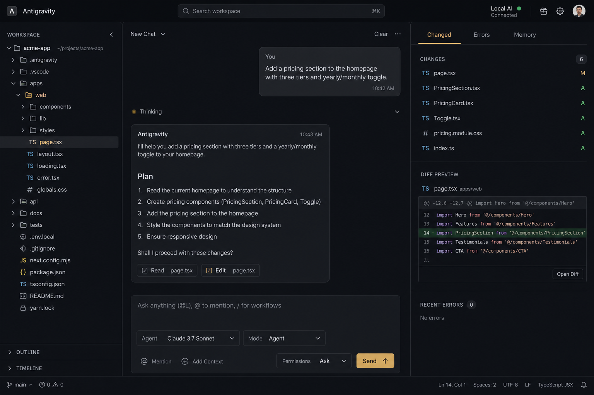
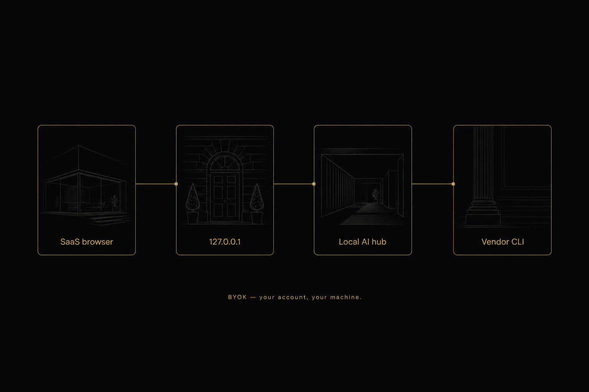

# Local AI

A local hub that lets your apps talk to AI coding CLIs you already have — Cursor, Claude Code, GitHub Copilot, Codex, and Aider — so **you** pay the provider, not the app.

**Docs (start here):** [Usage](docs/usage.md) · [SaaS / app integration](docs/integration-examples.md) · [Overview](docs/overview.md) · [Install](docs/installation.md) · [FAQ](docs/faq.md)



<p align="center"><sub>One workbench: workspace, chat, agent/model, approvals, Changed / Memory.</sub></p>



<p align="center"><sub>Your page stays in the browser. Tokens stay on the user’s CLI account.</sub></p>

## Who is this for?

- **Indie SaaS** — ship an “AI coding” feature without putting Anthropic/OpenAI keys (or the invoice) on your servers. Each customer runs Local AI and uses their own CLI login.
- **Internal tools** — wiki bots, PR helpers, ticket drafts on engineer laptops, billed to existing Copilot or Claude seats.
- **Script hackers** — `curl` / Node against localhost when you already live in the terminal and don’t want another API SDK.

This is a **localhost bridge**, not a hosted model and not a prettier `claude` prompt. If you only want a TUI, use the vendor CLI directly.

## Overview

Local AI is a small workbench that runs on your machine (`http://127.0.0.1:5173`). It does not call Anthropic, OpenAI, or GitHub APIs itself. It starts the official CLI for the agent you pick, using the login and keys already on your computer.

That is the point: **bring your own account (BYOK)**. Apps stay out of the token bill. Prompts and code stay on your machine. You keep the same subscriptions you use in the terminal.

More detail: [docs/overview.md](docs/overview.md). Protocol and request shapes: [docs/usage.md](docs/usage.md).

## SaaS integration (the whole idea)

Your web app stays in the **browser**. It never sees the user’s API key. On *their* PC:

```
SaaS page  →  http://127.0.0.1:5173/api/prompt  →  Local AI hub  →  claude / copilot / … CLI
```

```html
<button id="ask">Ask my local Claude</button>
<pre id="out"></pre>
<script>
  // This fetch goes to the USER'S machine, not to your cloud.
  document.getElementById("ask").onclick = async () => {
    const out = document.getElementById("out");
    out.textContent = "Talking to Local AI…";
    try {
      const status = await fetch("http://127.0.0.1:5173/api/status").then((r) => r.json());
      const claude = status.adapters.find((a) => a.id === "claude");
      if (!claude?.bin) {
        out.textContent = "Install Claude Code, then open Local AI and click Install / Sign in.";
        return;
      }
      const r = await fetch("http://127.0.0.1:5173/api/prompt", {
        method: "POST",
        headers: { "content-type": "application/json" },
        body: JSON.stringify({
          adapterId: "claude",
          text: "Summarize the current git diff in 3 bullets.",
          mode: "ask",
          permission: "auto",
          workspace: status.workspace,
        }),
      });
      const body = await r.json();
      out.textContent = body.error || body.text;
    } catch {
      out.textContent = "Local AI is not running. On this computer: npm run dev (or your installer), then retry.";
    }
  };
</script>
```

If `fetch` fails, the hub is down — tell the user to start Local AI. Do not silently fall back to *your* paid API. Full patterns (WebSocket streaming, sidecars, Python): [docs/integration-examples.md](docs/integration-examples.md).

## Features

- One UI for Cursor Agent, Claude Code, Copilot CLI, Codex, and Aider
- Uses each vendor’s CLI and **your** login — no shared API keys in this repo
- If a CLI is missing, the UI opens the **official install site**
- If you are signed out, the UI **asks you to sign in** (and opens the vendor login)
- Agent / plan / ask modes, plus ask / auto / yolo permissions
- Shared chat history and `MEMORY.md` under `~/.local-ai` (not dumped into your repo)
- Local HTTP (`GET /api/status`, `POST /api/prompt`) + WebSocket `/hub` so other tools on the same machine can plug in

## Installation

You need **Node.js 22.18 or newer** (this repo uses Node’s built-in TypeScript type-stripping). Git is useful for the Changed panel.

```bash
git clone https://github.com/Mokksh-bhatt/local-ai.git
cd local-ai
npm install
```

Install at least one model CLI from its vendor (this app will not download them for you):

| Agent   | Official site | Typical install |
| ------- | ------------- | --------------- |
| Cursor  | [cursor.com/download](https://cursor.com/download) | Windows: `irm https://cursor.com/install?win32=true \| iex` |
| Claude  | [code.claude.com](https://code.claude.com/docs/en/overview) | `npm i -g @anthropic-ai/claude-code` |
| Copilot | [Copilot CLI docs](https://docs.github.com/en/copilot/how-tos/set-up/install-copilot-cli) | `npm i -g @github/copilot` |
| Codex   | [Codex CLI](https://developers.openai.com/codex/cli) | `npm i -g @openai/codex` |
| Aider   | [aider.chat](https://aider.chat) | `pip install aider-chat` |

Full OS notes: [docs/installation.md](docs/installation.md).

## Quickstart

From the repo folder:

```bash
npm install
npm run dev
```

Open [http://127.0.0.1:5173](http://127.0.0.1:5173). Step-by-step UI + HTTP/WebSocket: [docs/usage.md](docs/usage.md).

1. Pick a workspace folder (the project the agent may edit).
2. Pick an agent. If it is not installed, click **Open site**, install, then **I’ve done this**.
3. If you are signed out, finish the vendor sign-in window, then refresh.
4. Type a prompt and send.

```bash
npm test
```

Change the port if 5173 is taken:

```bash
# Windows PowerShell
$env:PORT=5174; npm run dev

# macOS / Linux
PORT=5174 npm run dev
```

## Testing

No extra test runner — Node 22’s built-in `node:test` plus a small parser script. Mocks spawn `node -e` instead of a real vendor CLI.

```bash
npm test
```

That runs:

- `src/bridge.test.ts` — mocked CLI success, nonzero exit, missing binary
- `src/check.ts` — stream parsers and spawn argv

CI runs the same `npm test` on GitHub Actions (Node 22 and 24) for every push and pull request. See [`.github/workflows/ci.yml`](.github/workflows/ci.yml).

## More examples

Runnable copies (hub already running):

- [examples/node-basic](examples/node-basic) — Node `fetch` one prompt
- [examples/web-backend](examples/web-backend) — tiny localhost sidecar
- [examples/cli](examples/cli) — curl / PowerShell

## Configuration

Nothing in this repo is a cloud control plane. Useful knobs:

| What | Where |
| ---- | ----- |
| Hub URL | `http://127.0.0.1:5173` (or `PORT`) |
| Data dir | `~/.local-ai` (`%USERPROFILE%\.local-ai` on Windows) |
| Memory | `~/.local-ai/MEMORY.md` |
| Chat transcripts | `~/.local-ai/chats/` |
| Recent workspace | `~/.local-ai/state.json` |
| Skills | `~/.local-ai/skills/` |

The UI stores pane sizes in `localStorage` (`lai.left`, `lai.right`, `lai.composer`).

## Roadmap

- Keep adapters honest: only spawn official CLIs, never a second LLM wrapper
- Smoother first-run: install-from-site and sign-in prompts (in the UI now)
- No Gemini (removed on purpose)

Stuck? [docs/faq.md](docs/faq.md). How to contribute: [CONTRIBUTING.md](CONTRIBUTING.md).

## License

[MIT](LICENSE). You can use, modify, and ship this inside proprietary SaaS products. Keep the copyright notice. MIT does not grant your users a license to Anthropic, GitHub, OpenAI, or other CLI vendors — they still need their own accounts.

Apache-2.0 was the other usual choice (extra patent grant, `NOTICE` file). MIT is enough for SaaS reuse and stays one file for a small repo.
